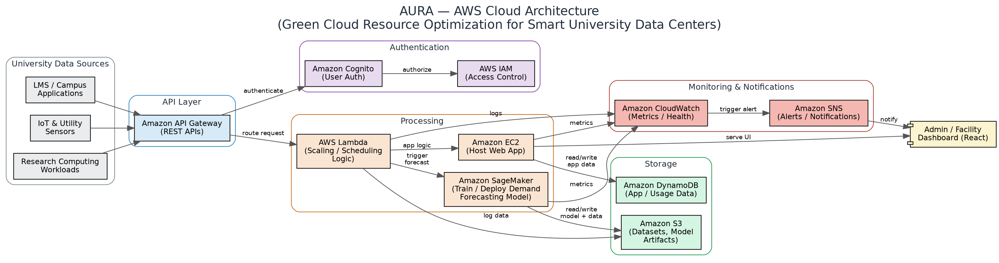
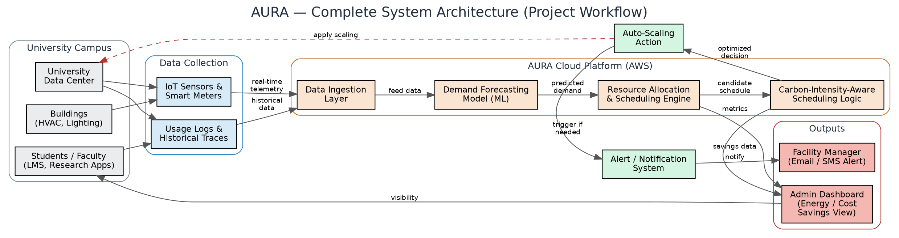

# AURA - Autonomous University Resource Allocator

> **Course:** BCSE355L - Cloud Architecture Design  
> **Instructor:** Dr. Priya V  
> **Academic Year:** 2026-2027

---

## Project Title

**AURA - Autonomous University Resource Allocator: Green Cloud Resource Optimization for Smart University Data Centers**

---

## Team Members

| Reg. No. | Name | Role | Primary Responsibilities |
|---|---|---|---|
| 24BIT0537 | **Pranav Hasban** | Frontend | Frontend development |
| 24BIT0548 | **Prakul Jain** | Backend & Database | Backend development, database integration |
| 24BIT0539 | **Agrani Anupam** | AI / Machine Learning | Dataset collection/preprocessing, demand-forecasting model |

---

## Problem Statement

University data centers handle highly variable workloads (LMS traffic, research computing, IoT/campus systems) but generally run on static, over-provisioned infrastructure, wasting energy during periods of low demand. Current green cloud computing research is generic to enterprise/IoT contexts and overlooks the predictable, cyclical nature of demand in academic environments (e.g. semester start, exam weeks, breaks). AURA aims to fill this gap by applying AI-driven resource optimization specifically tuned to university workload patterns, using AWS cloud services.

---

## Objectives

1. Develop an AI-driven resource allocation framework for workloads at university data centers.
2. Reduce energy consumption and carbon footprint of university cloud infrastructure using AWS services.
3. Predict academic-calendar-driven demand cycles (semester start, exam weeks, breaks) to enable proactive scaling.
4. Implement carbon-intensity-aware task scheduling for sustainable resource use.
5. Provide real-time monitoring and visualization of energy/cost savings via dashboards.
6. Ensure scalability and SLA compliance while optimizing for sustainability.

---

## Proposed Architecture / Framework




### Architecture Overview

The AURA framework is organized into **four layers**:

#### 1. Data Ingestion Layer
- **IoT & Utility Sensors:** Captures real-time telemetry from campus buildings and data-center hardware.
- **Usage Logs & Historical Traces:** LMS traffic, research computing workloads, and historical resource-utilization data.
- **Data Ingestion Layer (AWS):** Normalizes and routes incoming data via Amazon API Gateway.

#### 2. Authentication & API Layer
- **Amazon Cognito:** Authenticates dashboard users (students, faculty, facility staff).
- **AWS IAM:** Enforces least-privilege access control across all AWS services.
- **Amazon API Gateway:** Exposes REST APIs connecting the frontend, backend, and ML services.

#### 3. Processing & AI/ML Core
- **AWS Lambda:** Runs serverless scaling/scheduling logic in response to demand predictions.
- **Amazon EC2:** Hosts the AURA web application/backend.
- **Amazon SageMaker:** Trains and deploys the demand-forecasting model (predicting VM/resource utilization patterns from historical data).
- **Carbon-Intensity-Aware Scheduling Logic:** Combines forecasted demand with real-time carbon-intensity data to decide when/where to run energy-intensive tasks.

#### 4. Storage, Monitoring & Presentation Layer
- **Amazon S3:** Stores datasets and trained model artifacts.
- **Amazon DynamoDB:** Stores application and usage data.
- **Amazon CloudWatch:** Monitors resource usage and system health in real time.
- **Amazon SNS:** Sends alerts/notifications (e.g. scaling events, anomalies) to facility managers.
- **Dashboard (React):** Visualizes energy/cost savings and utilization metrics for administrators.

### Workflow Summary

```
[Campus Sensors / Usage Logs] → [Data Ingestion] → [Demand Forecasting Model]
        → [Resource Allocation & Scheduling Engine] → [Carbon-Aware Scheduling Logic]
                → [Auto-Scaling Action] + [Alerts] → [Dashboard / Facility Manager]
```

If forecasted demand shifts significantly, the scheduling engine re-evaluates the allocation plan, ensuring the system stays responsive to real academic-calendar-driven demand changes rather than relying on static provisioning.

---

## Technology Stack

| Layer | Technology | Purpose |
|---|---|---|
| **Cloud Services (AWS)** | EC2, S3, Lambda, SageMaker, CloudWatch, SNS, API Gateway | Hosting, storage, compute, ML training/deployment, monitoring, notifications, API exposure |
| **Authentication** | Amazon Cognito, AWS IAM | User authentication and least-privilege access control |
| **Backend** | Node.js, Express | REST API and application logic |
| **Frontend** | React | Admin/facility dashboard for energy and cost visualization |
| **Database** | Amazon DynamoDB | Application and usage data storage |
| **ML / AI** | Python, TensorFlow | Demand-forecasting model training and evaluation |
| **Other Tools** | Git, GitHub, Docker, Jupyter Notebook, Postman | Version control, containerization, model experimentation, API testing |

---

## Dataset Details

- **Dataset Name:** CU-BEMS: Smart Building Electricity Consumption and Indoor Environmental Sensor Data
- **Source:** Chulalongkorn University (Bangkok) Building Energy Management System; Pipattanasomporn et al., *Scientific Data* 7, 241 (2020)
- **URL:** https://doi.org/10.6084/m9.figshare.11726517
- **Size:** 788 MB (14 CSV files, one per floor per year)
- **Number of Records:** ~5.4 million 1-minute readings, 7 floors, July 2018 to December 2019
- **Number of Features:** 11 to 36 per floor: AC, lighting and plug-load power (kW) for each zone, plus indoor temperature, humidity and light level
- **Data Type:** Multivariate time series, tabular (CSV)
- **License:** CC BY 4.0
- **Purpose of Use:** Trains AURA's demand-forecasting model on real university-building load, which shows the weekday, weekend, holiday and term-break cycles AURA uses to schedule resources proactively
- **Preprocessing:** Aggregate meters into building load, resample to 15 min / 1 h, interpolate short gaps, drop periods where floors are missing, add calendar and Thai public-holiday features. See [dataset/dataset_description.md](dataset/dataset_description.md)

---

## Results

Hyper-parameters and scheduling settings were **tuned on the validation period (Jun-Aug 2019) and reported once on the held-out test period (Aug-Oct 2019)**.

| | Result (test period) |
|---|---|
| Demand forecast (LSTM, next 24h) | MAE **35.9 kW**, MAPE 20.5%: 20% lower error than a same-hour-last-week baseline (44.9 kW) |
| Data-center energy vs always-on | **−39.5%** (8,281 kWh over 1,704 hours) |
| CO₂ vs always-on | **−41.3%** (1,589 kg); carbon-aware batch placement adds 2.3 points of this |
| SLA compliance | **99.53%** of hours with enough capacity for interactive demand |

**These are simulated, not measured.**
- The CU-BEMS **building load stands in for campus server demand**.
- The **48-server fleet, 40% idle power, PUE 1.5 and 20% deferrable work are assumptions**.
- Carbon intensity is real hourly **UK grid** data for the same dates. It is not Thailand's grid.

Details: [results/README.md](results/README.md) and [results/simulation/README.md](results/simulation/README.md).

---

## Running locally

```bash
# 1. Data and model (Python 3.10 to 3.12 virtual environment; TensorFlow doesn't support Python 3.14 yet)
python -m pip install -r src/ml_model/requirements.txt
python src/ml_model/download_data.py          # 788 MB from figshare
python src/ml_model/preprocess.py
python src/ml_model/train_lstm.py --data dataset/processed/cubems_building_15min.csv --out results/model
python src/ml_model/fetch_carbon.py --start 2019-05-31 --end 2019-10-23 --out dataset/processed/carbon_hourly.csv
python src/ml_model/simulate.py --carbon dataset/processed/carbon_hourly.csv

# 2. API on http://localhost:3000 (reads results/simulation/)
cd src/backend && npm install && AUTH_DISABLED=true npm start

# 3. Dashboard: create src/frontend/.env.local with
#    VITE_USE_MOCK=false, VITE_AUTH_DISABLED=true, VITE_API_BASE_URL=http://localhost:3000
cd src/frontend && npm install && npm run dev
```
The processed building file and the trained model are committed, so steps 2 and 3 work without re-running step 1.

AWS deployment (CloudFormation; not yet tested on a real account): [src/aws/README.md](src/aws/README.md).

---

## Interactive simulator

The **Simulator** page (`/simulator`) lets a teacher try their own numbers: server count, idle/peak watts, share of flexible workload, grid carbon profile, date range and calendar events (exams, breaks). The trained LSTM forecasts demand for that period and the allocation simulation returns KPI cards (energy, CO₂, cost, SLA), hourly charts against an always-on baseline, and plain-language recommendations. It also offers:
- a **forecast preview** for any single day (forecast vs actual where known),
- **scenario compare**: save up to 3 runs (kept in the browser) and view them side by side,
- an **experimental CSV upload** (`timestamp,kw`, 16-31 days) to run the simulation on your own load data.

- **Export**: the Export menu on the results offers a CSV (inputs, summary, hourly rows) and a printable A4 report (open it, then Print / Save as PDF) with KPIs, charts, a plain-language summary, rough everyday equivalents (km driven, tree-years, home-days; assumptions listed), the model's accuracy and an uncertainty hint. Everything is built in the browser from the run result.

- **Run now or later?** (Advisor section): describe a job (hours, kW or servers × watts, look-ahead up to 48 h, optional deadline) and AURA finds the cleanest start time from the live UK carbon-intensity forecast (`POST /api/advisor`; backend-only fetch, cached 10 min, 8 s timeout, falls back to a typical profile with an OFFLINE badge). The data is for the UK grid.

Dates are limited to the CU-BEMS data (15 Jul 2018 to 21 Oct 2019). Start the backend with the Python venv (`PYTHON=<venv python> AUTH_DISABLED=true npm start` in `src/backend`) so `/api/simulate` can load the LSTM; the first request waits ~5 s for the model.

Endpoints: `POST /api/simulate`, `GET /api/forecast/preview`, `POST /api/upload`; see [docs/api-contract-interactive.md](docs/api-contract-interactive.md). Without the backend, run the contract mock: `cd src/frontend && npm run mock`. Integration tests: `API_URL=http://localhost:3000 npm run test:integration` (starts the mock if `API_URL` is unset).

---

## Repository Structure

```
AURA_Cloud_Project_2026/
├── README.md
├── LICENSE
├── .gitignore
├── docs/
│   └── README.md
├── architecture/
│   ├── AWS_Architecture.png
│   ├── System_Architecture.png
│   └── README.md
├── dataset/
│   ├── raw/
│   │   └── README.md
│   ├── processed/
│   │   └── README.md
│   └── README.md
├── src/
│   ├── frontend/
│   │   └── README.md
│   ├── backend/
│   │   └── README.md
│   ├── ml_model/
│   │   └── README.md
│   └── aws/
│       └── README.md
├── results/
│   └── README.md
└── presentation/
    └── README.md
```

---

## License

This project is developed for academic purposes as part of the **BCSE355L - Cloud Architecture Design** course at VIT Vellore.
