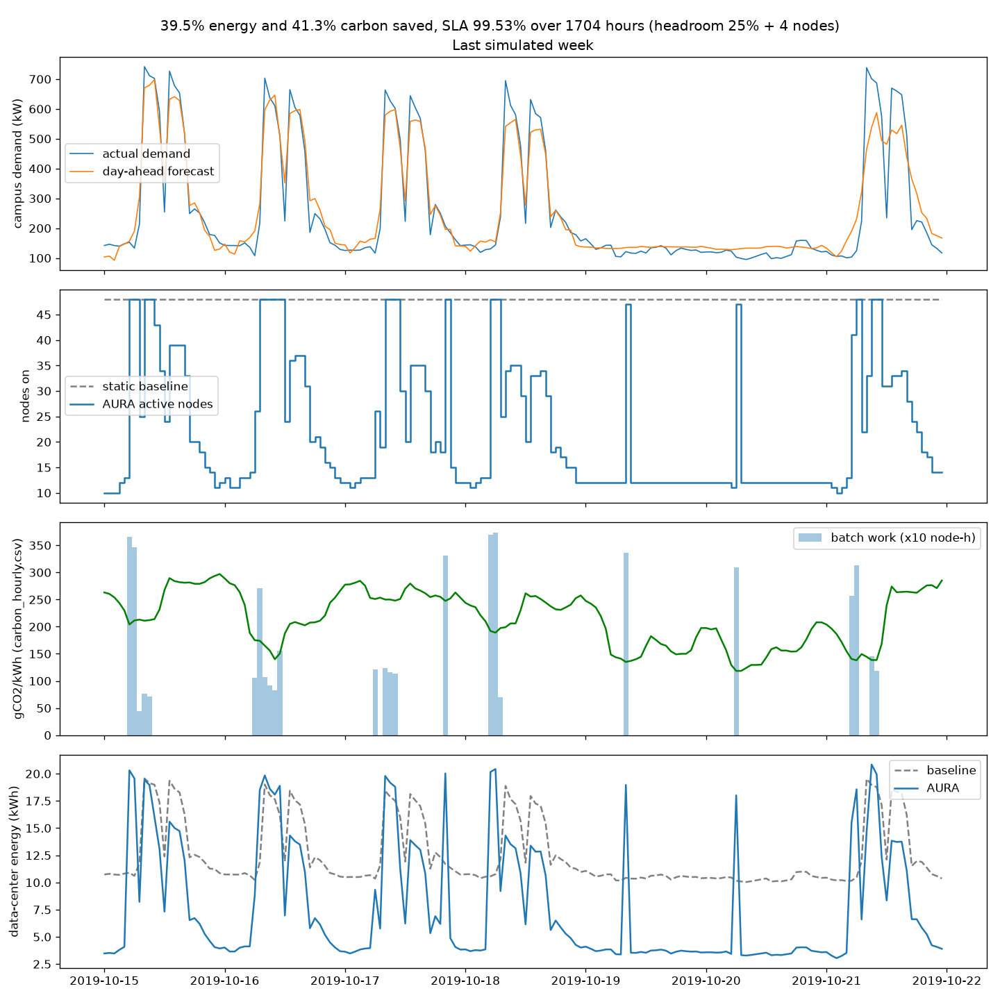

# AURA allocation simulation

Produced by [`src/ml_model/simulate.py`](../../src/ml_model/simulate.py). All numbers below are computed from the simulated hours; none are typed in.

## Method
- **What's simulated:** a replay of the model's held-out **test period**, 2019-08-12 00:00 to 2019-10-21 23:00 (1,704 hours, Bangkok local time).
- **Forecast:** every midnight, the trained LSTM forecasts the next 24 hours of campus demand using only data before that midnight.
- **AURA policy:**
  - keep `ceil(forecast interactive demand × (1 + headroom) + buffer nodes)` servers on, plus room for the batch work planned for that hour
  - put the day's deferrable batch work into the hours with the lowest grid carbon intensity that have spare capacity
  - at run time, serve interactive demand first and carry batch work that doesn't fit to the next hour
  - if interactive demand exceeds the servers that were on, scale up reactively; that hour counts as an **SLA miss**
- **Baseline:** static provisioning. All 48 servers are on 24/7 and work runs when it arrives.

### Tuned on validation, reported on test
The headroom and spare-server buffer were chosen on the **validation period** (2019-06-01 to 2019-08-11, before the test period), using the rule *highest energy saving with SLA ≥ 99.5%*. The full grid is in [`headroom_validation.csv`](headroom_validation.csv). The rule picked **25% headroom + 4 servers** (38.0% energy saving and 99.87% SLA on validation). Those settings were then frozen, and the test period was run once.

The fleet size (48 servers = peak training-period load) is also derived from the training period only.

## Results (test period)

| | AURA | Static baseline | Change |
|---|---|---|---|
| Data-center energy | 12,674 kWh | 20,955 kWh | **−39.5%** (8,281 kWh) |
| Emissions | 2,256 kg CO₂ | 3,845 kg CO₂ | **−41.3%** (1,589 kg) |
| Electricity cost | | | **−$993.71** |
| Servers on (average) | 21.0 | 48 | |
| SLA compliance (hours with enough capacity for interactive demand) | **99.53%** | 100% | |

**What the carbon-aware scheduling adds on its own** (`--no-carbon-shift`, batch runs on arrival): energy saving is 39.5% either way, but carbon reduction falls from 41.3% to **39.0%**. So carbon-aware placement adds **2.3 percentage points** (about 88 kg CO₂). It costs 0.4 points of SLA (99.94% → 99.53%), because the batch capacity spread over busy hours no longer doubles as extra headroom.

**Earlier numbers.** An earlier run picked the same 25% + 4 setting by looking at test-period results directly. It reported the same 39.5% / 41.3% / 99.53%; only the selection procedure is corrected here.

| Validation grid (selected row in bold) | Energy saved | SLA |
|---|---|---|
| 15% + 2 servers | 42.5% | 97.24% |
| 15% + 4 | 39.7% | 99.46% |
| **25% + 4** | **38.0%** | **99.87%** |
| 25% + 6 | 35.2% | 99.93% |
| 50% + 8 | 28.4% | 100% |



## Assumptions (stand-ins, not measurements)
- **Demand proxy:** the CU-BEMS building's electrical load stands in for campus server demand. Demand in servers = building kW × 48 / peak training-period kW.
- **Fleet:** 48 servers (`c5.xlarge`-class), never fewer than 4 on.
- **Server power:** 0.12 kW idle and 0.30 kW at full load, so idle is **40%** of peak and power is linear in utilisation.
- **Cooling overhead:** PUE 1.5.
- **Deferrable work:** 20% of each day's work.
- **Price:** $0.12/kWh.
- **Carbon intensity:** hourly **UK national grid** intensity for the same dates, from the [Carbon Intensity API](https://carbonintensity.org.uk) (CC BY 4.0), aligned on UTC time ([`fetch_carbon.py`](../../src/ml_model/fetch_carbon.py)). 154 of 6,972 half-hours used the API's forecast value because no actual was recorded. The building is in Bangkok, so this is real grid behaviour but **not Thailand's grid**. Without `--carbon`, the script uses an illustrative Thai-style profile.
- **Batch placement:** uses the day's carbon intensity values as if known in advance. A live system would use the API's day-ahead forecast.

## Files

| File | Content |
|---|---|
| `energy_metrics.json` | Hourly records served at `/api/metrics/energy`: energy, baseline energy, cost, carbon, active servers, forecast vs actual demand, SLA flag |
| `savings.json` | Totals plus all assumptions (`/api/metrics/savings`) |
| `allocations.json` | Server status at the last simulated hour (`/api/allocations`) |
| `alerts.json` | Scaling, SLA-miss, carbon-shift, holiday and forecast-error events, newest first (`/api/alerts`) |
| `forecast.json` | Next-24h forecast from the end of the data (`/api/forecast`) |
| `headroom_validation.csv` | Validation-period grid used to pick the headroom |
| `simulation.png` | Last simulated week: demand vs forecast, servers on, carbon intensity with batch placement, energy |

## Reproduce
```bash
python src/ml_model/fetch_carbon.py --start 2019-05-31 --end 2019-10-23 --out dataset/processed/carbon_hourly.csv
python src/ml_model/simulate.py --carbon dataset/processed/carbon_hourly.csv
python src/ml_model/simulate.py --carbon dataset/processed/carbon_hourly.csv --start 2019-06-01 --end 2019-08-11 --headroom 0.25 --buffer-nodes 4 --quiet
```
The last command is one point of the validation grid.
